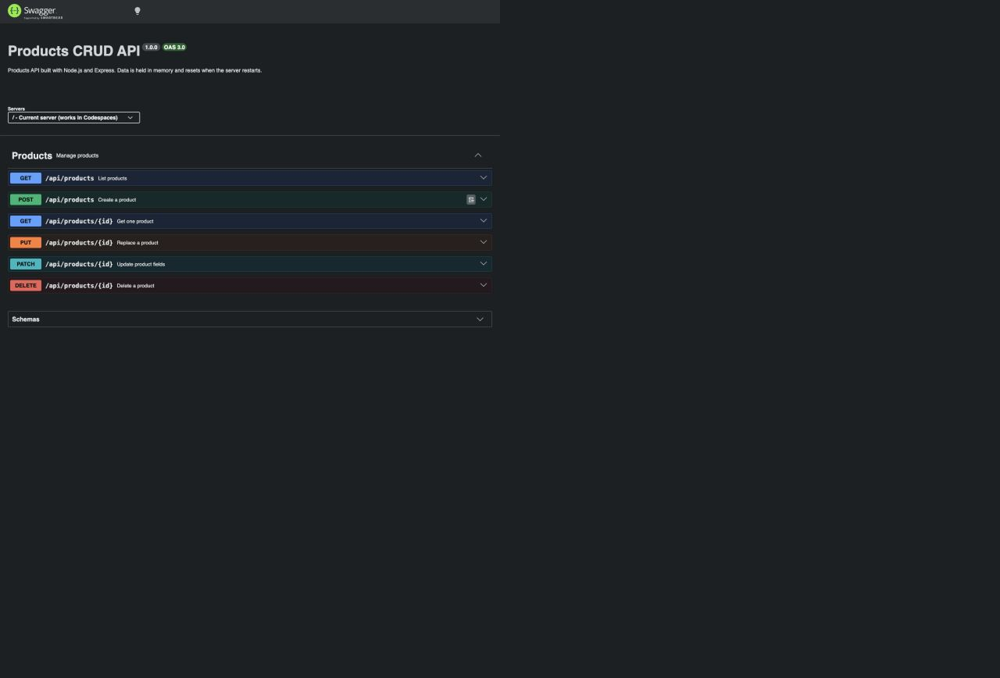
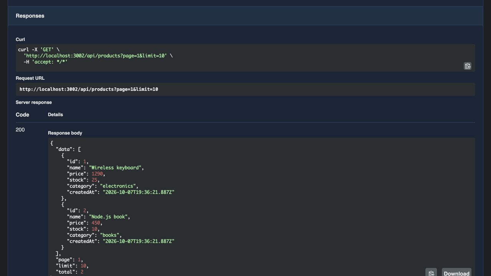
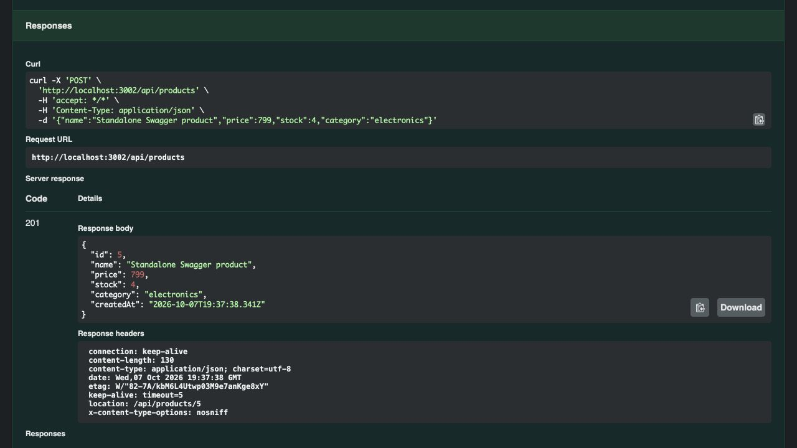
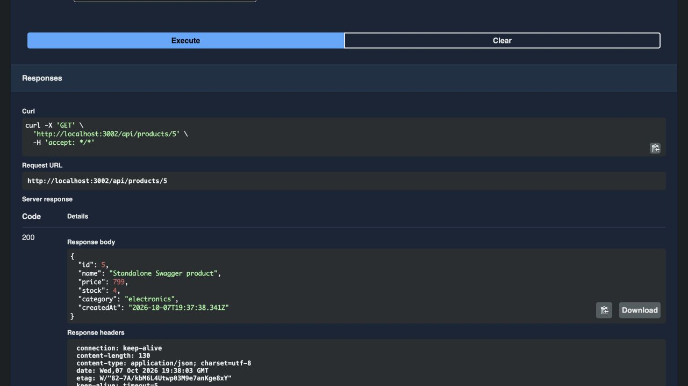
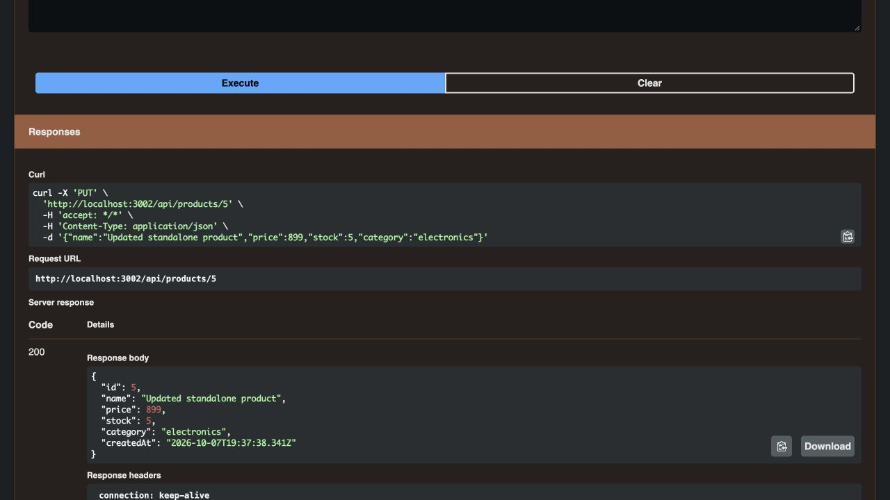
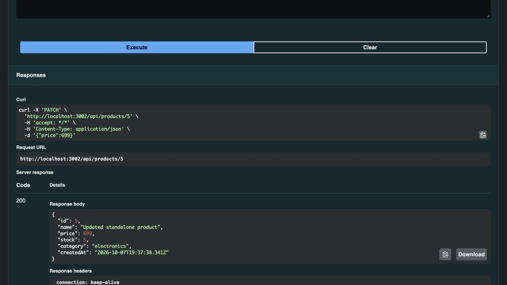
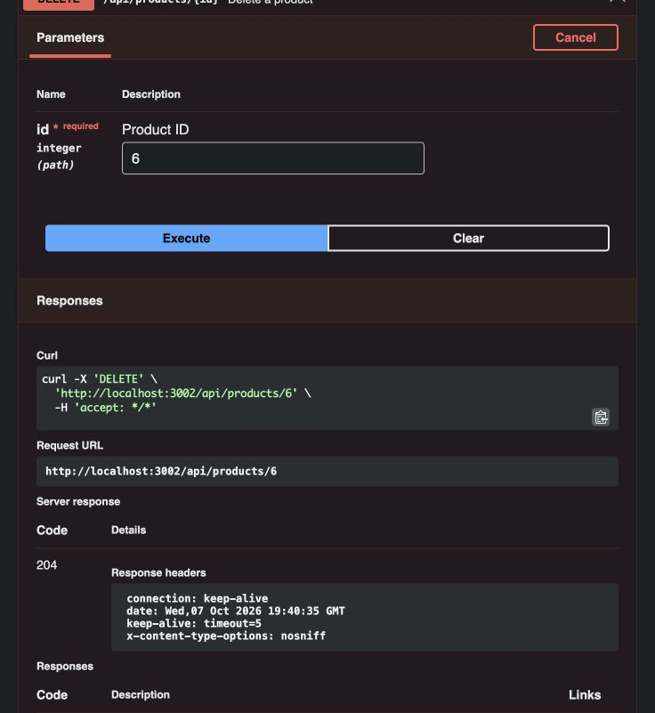

# งานข้อ 2: Products CRUD + Swagger UI

**ใส่ลิงก์ตรงนี้:** https://github.com/Akirakato112233/products-swagger-api

Repository เป็น **Public** และมี Node.js + Express Products CRUD API พร้อม OpenAPI 3.0.3 และ Swagger UI ที่ `/api-docs`

หลักฐานภาพทดสอบด้านล่างถ่ายจาก Swagger UI ของรีโปนี้ในเครื่องที่ `http://localhost:3002`
[ดูผล curl ทั้ง 6 endpoint](evidence/local-curl-output.txt)

## หน้าแรก Swagger UI

## GET /api/products — 200 OK

## POST /api/products — 201 Created

## GET /api/products/{id} — 200 OK

## PUT /api/products/{id} — 200 OK

## PATCH /api/products/{id} — 200 OK

## DELETE /api/products/{id} — 204 No Content

